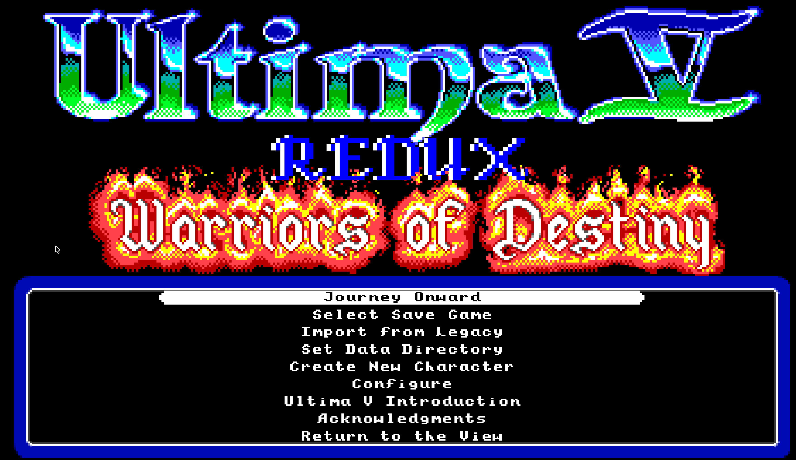

# Ultima V Redux



**Return to Britannia. Rediscover the world of Ultima V.**

A modern Go recreation of **Ultima V: Warriors of Destiny**, with enhanced
presentation, quality-of-life improvements, and a developer Debug Workbench.
Playing requires files from your own copy of the original MS-DOS PC game, such as
the GOG edition.

**[Download the preview](https://github.com/bradhannah/UltimaVRedux/releases)**
· [Installation & setup](docs/INSTALL.md)
· [Report a bug](https://github.com/bradhannah/UltimaVRedux/issues/new/choose)

> **Public preview:** downloadable builds are available for macOS, Windows and
> Linux; see [platform status](docs/INSTALL.md#platform-status) for what has been
> verified on each.

This is a free, non-commercial fan project. Project-authored source code remains
MIT-licensed; bundled media has separate terms described in [Asset credits](ASSET_CREDITS.md).

## Journey onward

Explore Britannia's towns, wilderness, and dungeons. Meet its inhabitants, assemble
your party, and face tactical battles in a world of magic and mystery.


*Explore West Winds by torchlight: a wooded coastline, a full party, and the journey ahead.*

These screenshots show existing development builds; details may differ in the
current preview.

## Installation

### Download and play

Get the archive for your platform from the
[releases page](https://github.com/bradhannah/UltimaVRedux/releases),
verify it against `SHA256SUMS`, and extract the whole archive. **Go is not required
for downloaded builds.** From the extracted folder, run `./ultimav` on macOS/Linux
or `.\ultimav.exe` in Windows PowerShell. These are unsigned preview binaries;
see the release notes and [download guidance](docs/INSTALL.md#downloaded-binaries).

### Install from source

Install the latest patch of **Go 1.27** or newer. See the short
[Windows, macOS, and Linux Go setup instructions](docs/INSTALL.md#install-go).
Then install the preview:

```sh
go install github.com/bradhannah/UltimaVRedux/cmd/ultimav@main
```

Launch the executable from the directory printed by `go env GOBIN`; if empty,
use `bin` under the first directory printed by `go env GOPATH`. With Go's default
paths, run `"$HOME/go/bin/ultimav"` on macOS/Linux or
`& "$HOME\go\bin\ultimav.exe"` in Windows PowerShell. An older `ultimav` on
`PATH` can otherwise launch a different program after a successful install.
See [starting the game](docs/INSTALL.md#start-the-game) for copyable commands.

Repeat the installation command to update. The [installation guide](docs/INSTALL.md)
also covers local builds, original-game setup, and configuration recovery.

Source installation needs Go, but not a source checkout, Node, Make, or a C
compiler.

## Original game files

Ultima V Redux needs the complete original **MS-DOS PC** game folder; the Amiga,
Atari ST, Commodore 64 and Apple II versions use different files. First-run setup
offers three practical routes:

1. Confirm a verified existing installation found through supported GOG/Heroic
   discovery or known local locations.
2. Copy your original game files into the **UltimaV** folder directly under your
   home directory, as shown by setup, then choose **Check Again**.
3. Choose **Open Settings File**, edit the game-data location in your text editor,
   save it, and choose **Check Saved Settings**.

Fresh configuration leaves the data location unset; setup asks for confirmation
even when it finds just one valid installation.
An already valid configured path is retained. The screen shows the resolved home
folder and settings filename; custom locations are entered in the external
settings editor. There are no in-game path fields. The game does not download
original assets for you.

To import a playthrough, the title menu reads `SAVED.GAM` and `SAVED.OOL` only
from the active game-data directory. For a save pair elsewhere, use the
[command-line save converter](docs/details/SAVE_CONVERTER.md).

## Controls

The game is played with the keyboard. Commands use the original's letter keys
(for example **A**ttack, **T**alk, **L**ook); press `/` in game for the full list.
Esc opens the menu for saving, loading, settings and quitting, and closing the
window during play offers to save first. Settings, saves and the crash log live
in your home folder; see [files and folders](docs/INSTALL.md#files-and-folders).

## Reports and suggestions

The [Game Facts](docs/gamefacts/README.md) cover 39 topics with stable behavioral
IDs, algorithms, compatibility formats, and explicit Redux comparisons. See the
[documentation catalog](docs/README.md) for system contracts and the
[development guide](docs/DEVELOPMENT_GUIDE.md) for contributor setup.

Please [open an issue](https://github.com/bradhannah/UltimaVRedux/issues/new/choose)
for bugs, installation difficulties, behavioral corrections, or suggestions.
Include the game version, operating system, and steps to reproduce the problem.

The maintainer currently owns implementation. Please read
[CONTRIBUTING.md](CONTRIBUTING.md) and open an issue before preparing a code PR.

## License

Project-authored source is provided under the [MIT License](LICENSE). Bundled
fonts, media, and fixtures retain their accompanying notices and applicable
rights; their inclusion does not make all media MIT-licensed. The complete
original Ultima V installation needed to play is externally supplied by the
player. Original game material retains its existing rights.

See [Asset credits and media terms](ASSET_CREDITS.md) for the music sources,
font notices and individual sound-effect attribution, including non-commercial
media licences and remaining provenance limitations.
