# Crafting and Housing: Player Manual

Crafting and Housing is an optional Redux addition: the original *Ultima V* has no
gathering, crafting, building or land ownership. With it, the party can cut wood and
quarry stone, craft its own tools, stake a claim on the open land of Britannia, and
build a house there, with walls, a door, furniture and a storage chest.

Everything happens on the **overworld surface**, on foot: never in towns, castles,
dungeons, the Underworld, combat, or aboard a horse, carpet or ship. Elsewhere the new
keys answer "Not here!" and cost nothing. The keys count only with **Alt** alone:
Ctrl, Shift or Meta held with them answers "What?". The rules quoted here are the defaults;
the exact rules and their IDs are in [CRAFTING Game Facts](gamefacts/CRAFTING.md), and
the design rationale is in [ADR-014](ADR/ADR-014-crafting-and-housing.md).

## Turning it on

The feature is **off by default**. While it is off, the game behaves exactly as the
original and the new keys answer "What?".

Open the game menu (**Esc**), choose **Configure**, stay on the **Gameplay** tab and
move to **Crafting and Housing**. Toggle it with **Space** and press **Enter** to
apply. The setting is saved with your configuration (`Gameplay.Crafting.Enabled`),
not with a save game, and it can be switched off again at any time: your materials,
claims and buildings stay in the save, waiting. While it is off, what you built stays
on the map as ordinary tiles: walls still block and a door still opens, but a storage
chest only answers "It's open!" without showing its contents, and claims give no
protection from monsters.

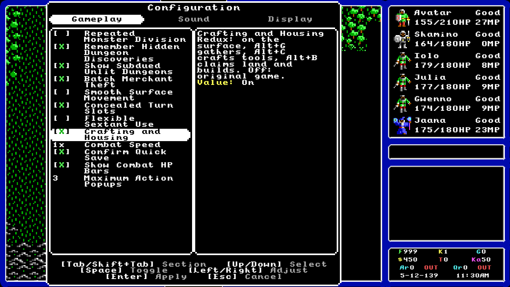

## Keys at a glance

| Keys | Command | What happens next |
|---|---|---|
| **Alt+G** | Gather wood or stone | Give a direction. |
| **Alt+C** | Craft tools | Choose a recipe from a menu. |
| **Alt+B** | Claim land and build | Choose from a menu, then give a direction. |
| **O** | Open | Opens your own storage chest like any chest. |

At every direction prompt, **Esc** cancels without spending a turn, and **Space**
passes with the normal command cost. Closing a menu with **Esc** is always free.
The in-game help (**/** or **?**) lists the three chords with the other overworld
commands.

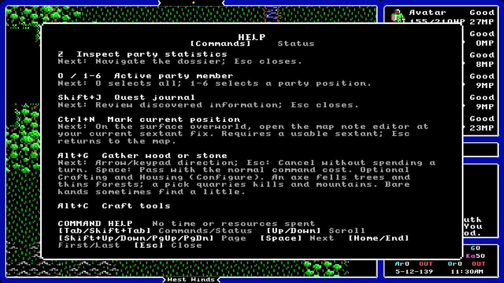

## What you carry

The party carries two **materials**, Wood and Stone (up to 9999 of each), and two
**tools**, the Axe and the Pick (up to 99 of each). The Craft and Build menus show
what you carry, for example "You carry 12 Wood, 7 Stone." Materials and tools also
appear in the party statistics (**Z**) under *Material* and *Tool*.

## Gathering

Stand next to a tree, a forest, hills or mountains, press **Alt+G** and give the
direction of the square to work.

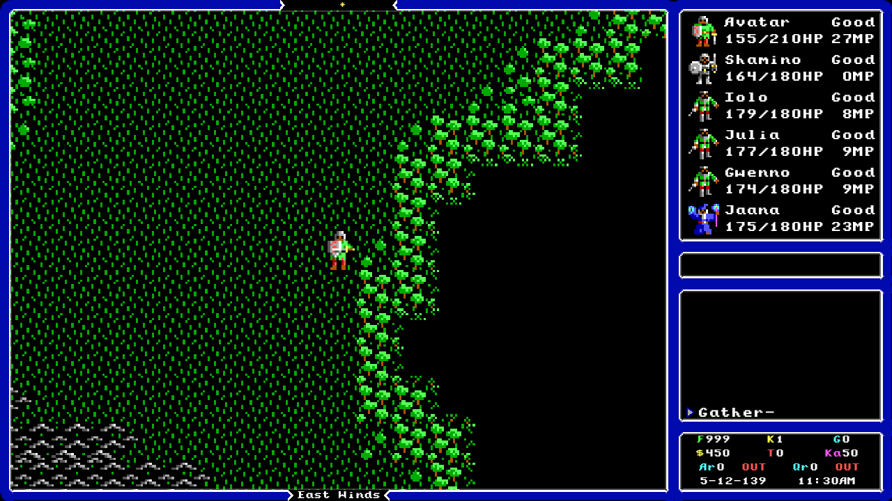

You can always start with your **bare hands**: one attempt in three turns up a
branch or a loose stone, and the land is left as it was. That is slow, but it is
enough to craft your first tools.

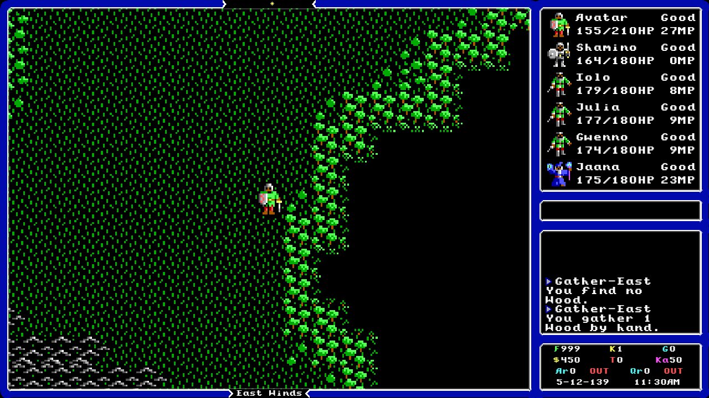

With the right tool you gather much more, and wood-cutting changes the land:

| Terrain | Tool | Yield with the tool | The square becomes | Bare hands |
|---|---|---|---|---|
| Tree, dead tree | Axe | 2 to 4 Wood | Grass | 1 Wood, 1 time in 3 |
| Tropical forest | Axe | 2 to 4 Wood | Forest | 1 Wood, 1 time in 3 |
| Forest | Axe | 2 to 4 Wood | Thick brush | 1 Wood, 1 time in 3 |
| Thick brush | Axe | 2 to 4 Wood | Brush | 1 Wood, 1 time in 3 |
| Brush | Axe | 2 to 4 Wood | Grass | 1 Wood, 1 time in 3 |
| Hills | Pick | 1 to 2 Stone | Unchanged | 1 Stone, 1 time in 3 |
| Mountains | Pick | 2 to 3 Stone | Unchanged | Refused: "You need a Pick!" |

So a forest thins step by step, down to open grass, while hills and mountains are
never used up. Anything else, or a square with a creature or dropped items on it,
answers "Nothing to gather!". Every attempt, lucky or not, costs one turn plus up to 10 minutes of
labour, and the party eats as time passes.

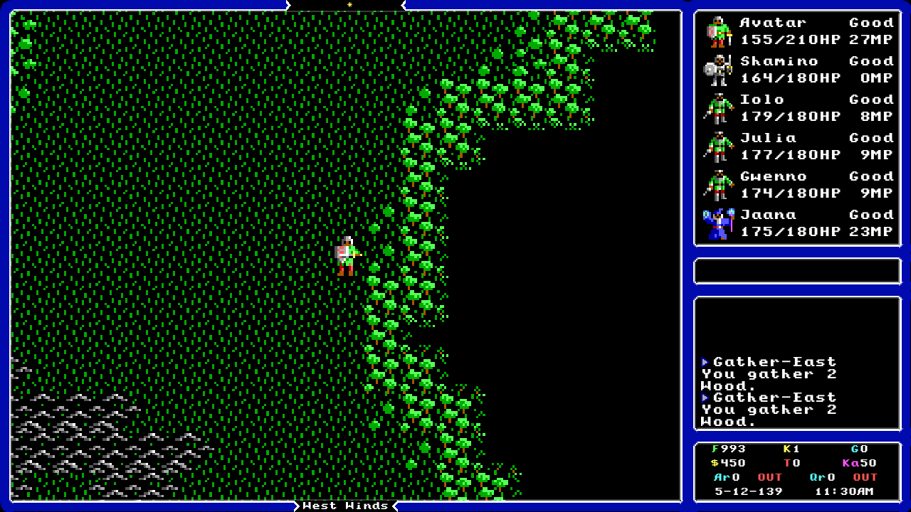

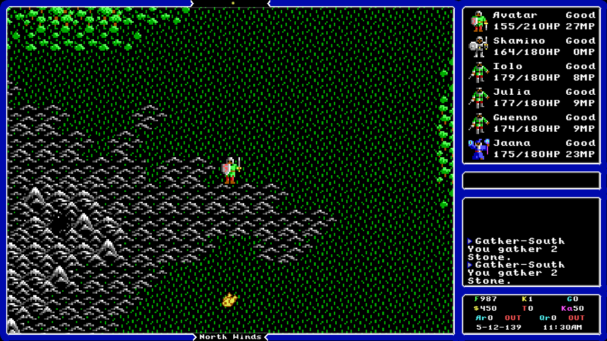

## Crafting tools

Press **Alt+C** to open the recipe menu.

| Tool | Cost | Time |
|---|---|---|
| Axe | 3 Wood, 2 Stone | 30 minutes |
| Pick | 4 Wood, 3 Stone | 30 minutes |

The menu description names any recipe you cannot afford yet. Choosing one anyway is
refused with the missing cost, and neither materials nor time are spent.

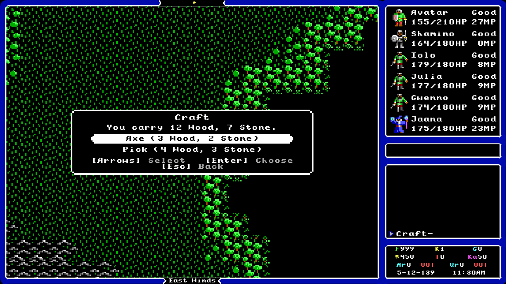


## Claiming land

You can only build on land you own. Stand in the middle of the land you want and
press **Alt+B**. Outside any claim, the Build menu offers **Stake a claim here**; its
description gives the price.

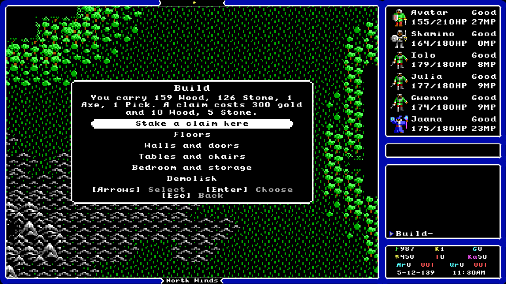

A claim is a square of **16 by 16** overworld squares centred on the party (the
party stands at offset 8,8 from its north-west corner). It costs **300 gold, 10 Wood
and 5 Stone** for the stakes, and takes 10 minutes to mark out. The claim is refused
when:

- the party already holds **4** claims;
- it would overlap another of your claims;
- any of its squares holds a town, castle, keep, shrine, dungeon, lighthouse or any
  other entrance;
- any of its squares holds a moongate (a buried moonstone);
- more than half of it is water;
- the party cannot pay.

A refused claim costs neither gold, materials nor time. Then the game asks for a name
of 1 to 24 letters, digits, spaces or punctuation, and **Enter** confirms it.
**Esc** clears the text. To back out, confirm an empty name: the game answers "A
claim needs a name." and nothing is paid.

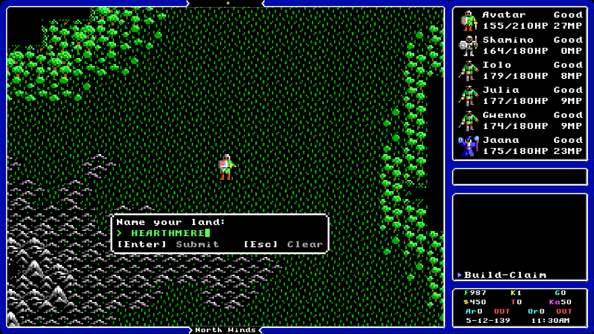

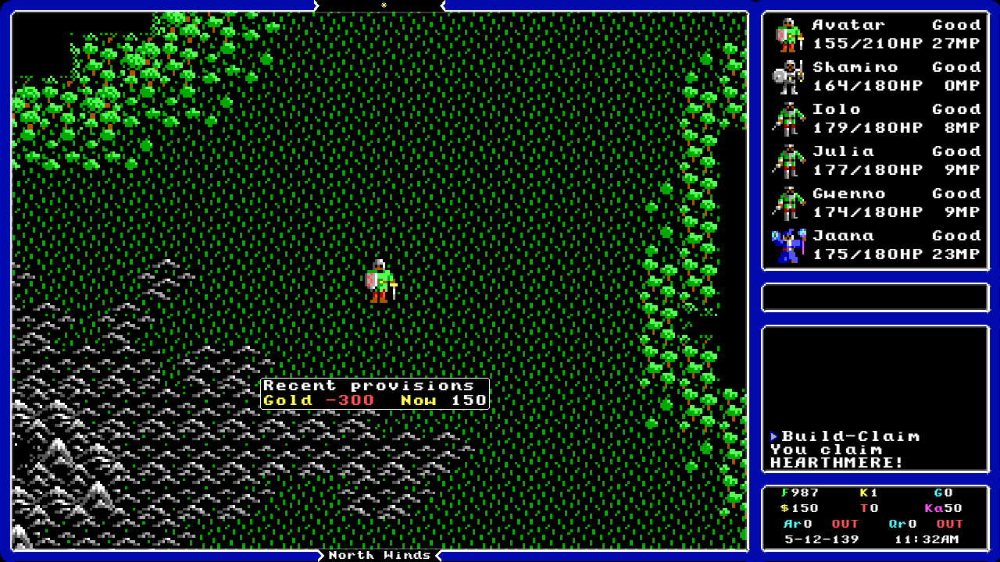

The claim is pinned on the Atlas (**M**) under **My Notes**, at its centre, without
needing a sextant. If the Atlas has no room left for notes, the claim still exists,
but it is not pinned. If one of your own notes already marks that square, it is kept
as it is. Claims are permanent: there is no way to abandon one.

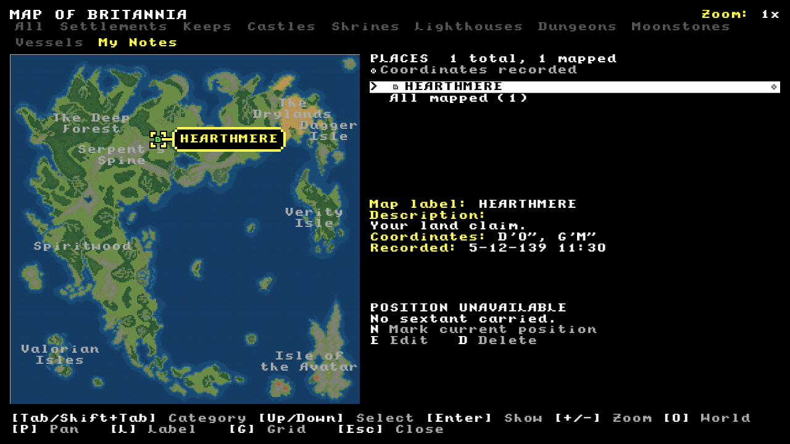

## Building

Inside your claim, **Alt+B** opens the Build menu with the claim's name, the
building categories and Demolish.

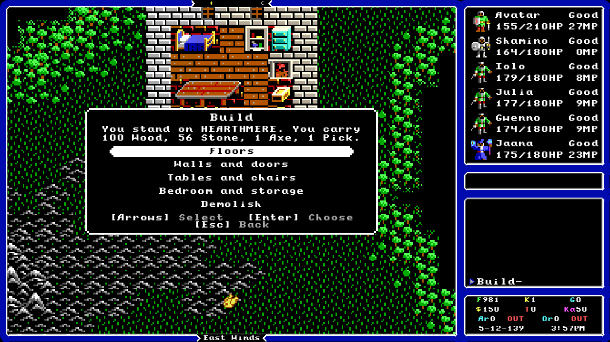

Choose a category, then a piece, then the direction of the square to build on. The
square must be next to the party, inside one of your claims, free of any object or
item, and be grass, brush, desert, path, ploughed field, or a floor you placed.
Each piece costs its materials and 5 minutes.

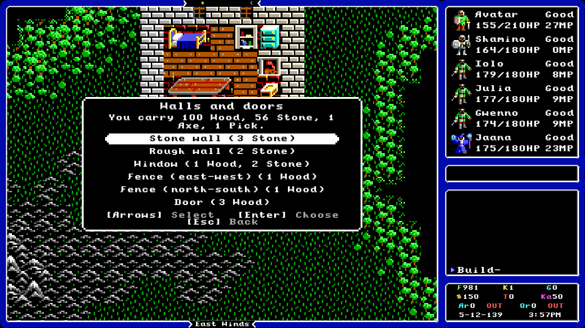

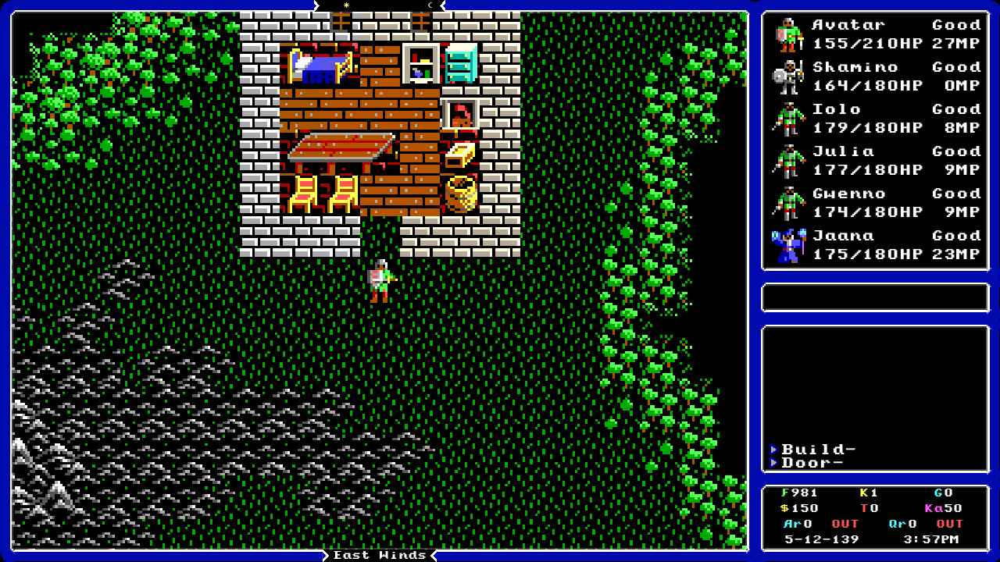

| Category | Pieces and costs |
|---|---|
| Floors | Wood floor (1 Wood), Stone floor (1 Stone) |
| Walls and doors | Stone wall (3 Stone), Rough wall (2 Stone), Window (1 Wood, 2 Stone), Fence east-west and north-south (1 Wood each), Door (3 Wood) |
| Tables and chairs | Table left end, middle and right end (2 Wood each), Chair facing forward, left, back or right (1 Wood each) |
| Bedroom and storage | Bed head and foot (3 Wood each), Dresser (3 Wood), Bookcase (3 Wood), End table (1 Wood), Barrel (2 Wood), Fireplace (1 Wood, 4 Stone), Storage chest (4 Wood) |

Every piece is an original *Ultima V* tile, and it behaves like one: walls block
movement and sight, and every other piece keeps the movement, sight and light
properties of the original tile. A bed is two pieces (head, then foot), and a long
table is a left end, any number of middles, and a right end.

Building on one of your floors keeps the original ground underneath: the floor is
replaced, and you get half of its cost back.

A finished house, seen from outside. With the door shut, the walls hide the inside:

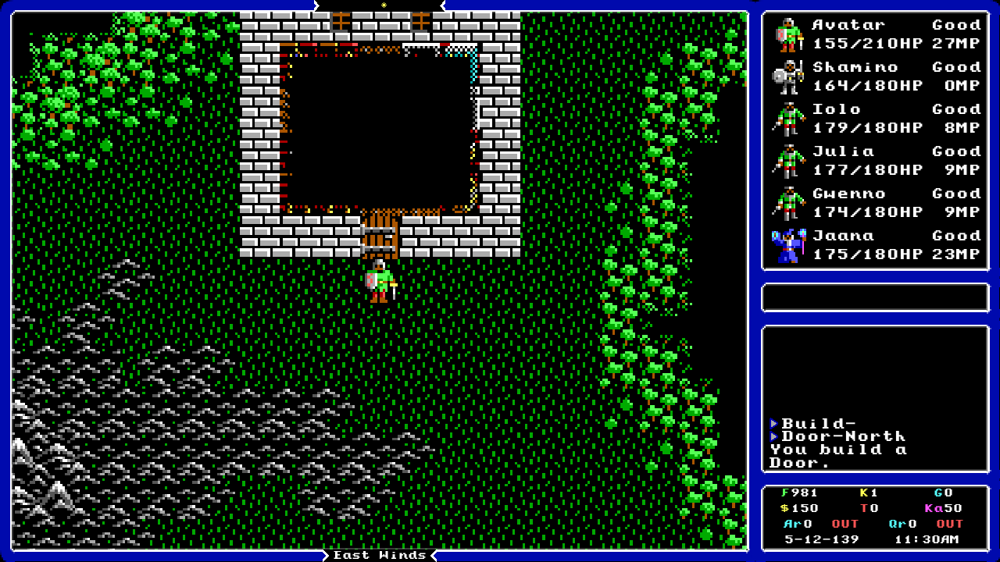

Open the door with **O** and step in. Like every overworld door, a door you built
stays open once opened.

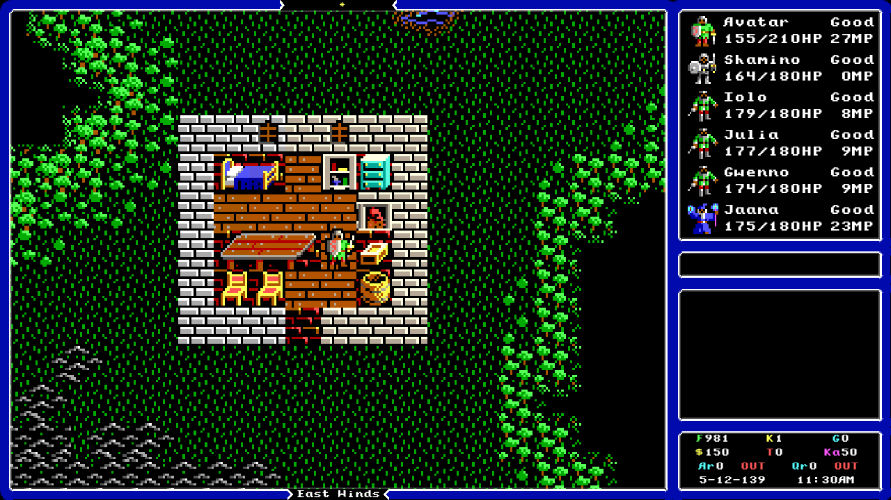

### Demolishing

**Alt+B**, **Demolish**, then a direction, removes a piece you placed. You get half
its cost back (rounded down), the original ground comes back, and it takes 5
minutes. You cannot demolish anything you did not build, and a storage chest must
be empty first.

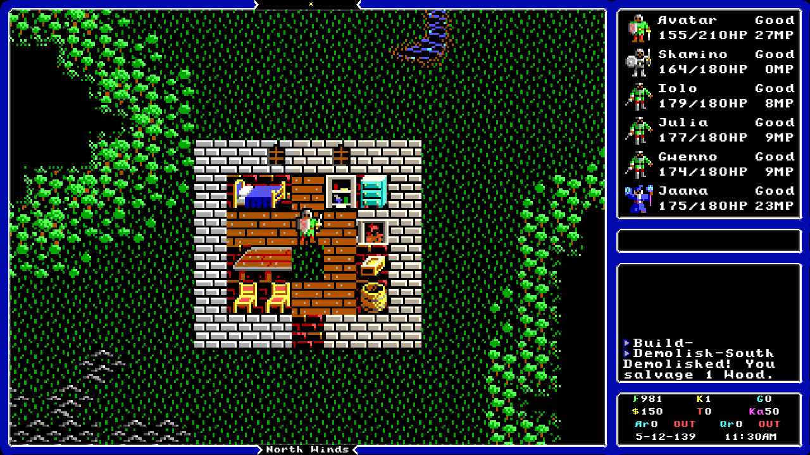

## The storage chest

A **storage chest** you built is your own property. Open it with **O** and a
direction: there is no lock, no trap, no random loot, and no karma cost.

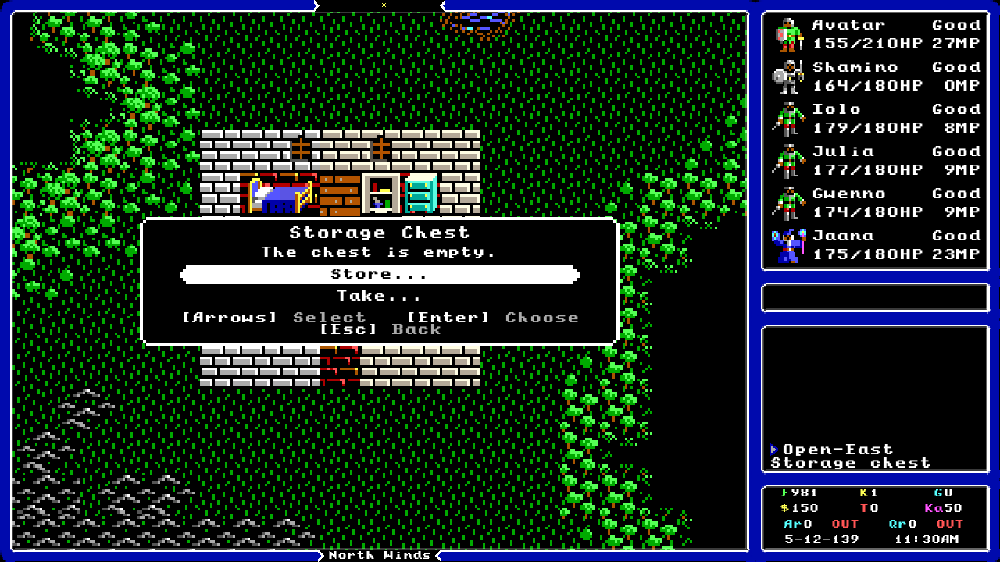

Choose **Store...** or **Take...**, then **Everything** or one category: Materials,
Tools, Gold, Food, or Torches, gems and keys. A transfer stops when the receiving
side is full. The menu stays open so you can move several things in a row; **Esc**
closes it.

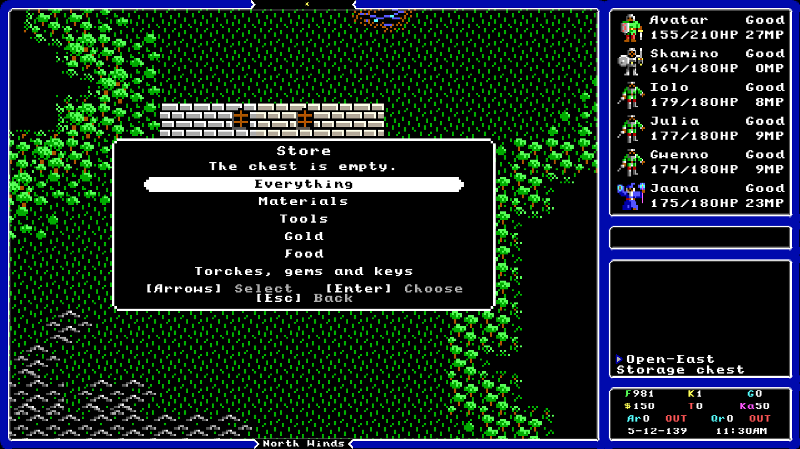

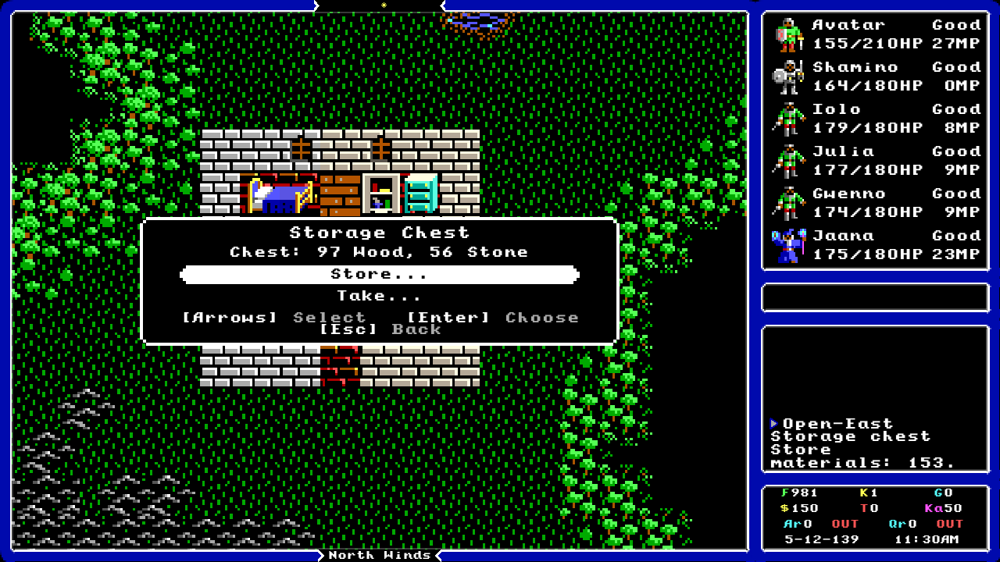

The contents are saved with the claim.

## Life on your own land

While the option is on, your claims are safe ground:

- No monster is generated while the party stands inside one of its claims, and none
  is generated onto a claimed square. Monsters already roaming nearby still move and
  fight as usual.
- A camp (**H**) pitched inside a claim is never ambushed.

## Saves

Materials, tools, claims, everything you built and the contents of every storage
chest are saved with the game (native save version 26). Saves made before this
feature load with an empty inventory of materials and no claims. Built pieces and
cut forests are stored as ordinary changes to the overworld map.

## Known limits

- Building only works on the overworld surface, never in towns, castles, dungeons
  or the Underworld, and never on a moongate square.
- A door stays open once it is opened, as every overworld door does.
- Claims cannot be abandoned, moved or resized.
- Cut forests do not grow back.

## For maintainers: regenerating the screenshots

The pictures in this manual are rendered by a capture test that drives a real game
scene through the production input handlers (Alt chords, direction keys and
menus), on a meadow at overworld 108,62. It is excluded from normal test runs by a
build tag. To regenerate them, set the game data path as for the integration tests
and run:

```bash
CRAFTING_MANUAL_DIR=/absolute/output/dir \
  go test -tags craftingmanual -run TestCraftingManualCapture ./cmd/ultimav/
```

Then copy the PNG files into `screenshots/crafting/`. The test is
`cmd/ultimav/crafting_manual_capture_test.go`.
